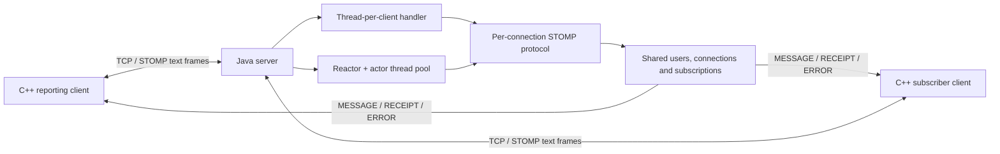

# STOMP Emergency Messaging

[](https://github.com/Idoco24/stomp-emergency-messaging/actions/workflows/ci.yml)

A Java messaging server and C++ terminal client for reporting simulated emergency
events to subscribed channels. Clients can log in, join channels, publish event
reports, collect summaries and disconnect with receipt acknowledgements.

Developed as System Programming Languages coursework at Ben-Gurion University.
This is an educational client/server project using a **subset of STOMP 1.2**,
not an operational emergency-response service or a full message broker.

## What it demonstrates

- TCP client/server communication across Java and C++.
- Two server concurrency models: thread-per-client and a selector-based reactor
  with an actor thread pool.
- Authentication state, topic subscriptions, per-recipient subscription IDs and
  atomic message IDs.
- UTF-8, null-terminated text frames and handling fragmented TCP reads.
- JSON event import and per-channel/per-user summaries.
- Unit tests, real network tests and CI on JDK 17 and 21.

## Architecture



Choose one server mode at launch. Each connection has a separate protocol and
frame decoder. The shared connection registry tracks login sessions and
subscriptions. The reactor queues output and flushes final receipts/errors before
closing a terminated session; the blocking handler serializes socket writes.

The C++ client has a terminal-input thread and one main loop that owns all socket
and protocol state. Keyboard input is queued, avoiding shared mutable protocol
maps between reader and writer threads.

## Requirements

- JDK **17 or later** and Maven **3.9 or later** for the server.
- Linux/WSL, a C++17 compiler, GNU Make and Boost.System development headers/library
  for the client. The Linux build is the supported, verified client setup.
- Python **3.9 or later** for the integration tests; no pip packages are needed.

On Ubuntu/WSL:

```sh
sudo apt-get update
sudo apt-get install -y g++ make libboost-system-dev python3
```

Check `java -version`, `mvn -version` and `g++ --version`. Maven must use a supported
JDK too. A native Windows C++ build has not been established; use WSL for the
client. The Java server can run on Windows or Linux. Commands below assume the
repository root is the working directory.

## Build

```sh
mvn --batch-mode --no-transfer-progress -f server/pom.xml verify
make -C client
```

The Java build runs 13 JUnit tests and creates an executable
`server/target/server-1.0.jar`. The C++ build produces
`client/bin/StompEMIClient`. Building does not automatically launch the client.

## Run

In terminal one, start either mode:

```sh
java -jar server/target/server-1.0.jar 7777 tpc
# Or, instead of the command above:
java -jar server/target/server-1.0.jar 7777 reactor
```

In terminal two:

```sh
mkdir -p summaries
./client/bin/StompEMIClient
```

Enter the following commands **one at a time**, waiting for the corresponding
confirmation before the next step:

```text
login 127.0.0.1:7777 alice demo-password
join alerts
report examples/events.json
summary alerts alice summaries/alice.txt
exit alerts
logout
quit
```

Wait for `Login successful` and `Joined channel alerts`. After `report`, allow the
echoed MESSAGE to arrive before requesting a summary; `reported` means the client
sent the report, not that every subscriber has processed it. The automated test
uses a subsequent receipt as a delivery barrier for its own session.

An additional client can log in as `bob`, join `alerts`, and use
`summary alerts alice summaries/received.txt` to summarize Alice's received
reports. `examples/events.json` contains synthetic exercise data only.

`exit alerts` unsubscribes from that channel. `logout` disconnects the session;
the terminal stays open for another login. `quit` or stdin EOF exits the program.
EOF closes an active socket; use `logout` first when you want a graceful STOMP
disconnect receipt. Command arguments and file paths currently cannot contain
spaces.

## Client commands

| Command | Purpose |
| --- | --- |
| `login host:port username password` | Open a connection and authenticate |
| `join channel` | Subscribe to an event channel |
| `report file.json` | Publish the events in a JSON file to its channel |
| `summary channel username file` | Write the matching received reports to a text file |
| `exit channel` | Unsubscribe after its receipt |
| `logout` | Request DISCONNECT and wait for its receipt |
| `quit` | Exit the terminal client |

Use bare channel names in client commands, e.g. `alerts`. The server accepts bare
names and `/alerts` as aliases. This normalization is an application convention,
not a general rule of STOMP. The course virtual host is `stomp.cs.bgu.ac.il` in
the CONNECT header; the TCP address remains the `host:port` entered at login.

The first login creates an in-memory account. Accounts and event subscriptions
are not persisted across server restarts. A username can have one active session.
This server requires senders to subscribe to the destination before publishing.

## Verify both languages together

After building both components, run on Linux/WSL:

```sh
python3 tests/integration_test.py
```

The script launches and stops its own local servers on temporary ports and checks
both `tpc` and `reactor`. Eight test methods cover real TCP routing, UTF-8 and
fragmented frames, recipient subscription IDs, unsubscribe/logout receipts,
abrupt disconnect/relogin, bad credentials, unauthenticated commands, and the
compiled C++ client's report/summary flow. A fake server also delays a CONNECTED
frame beyond the client's polling interval to verify partial-frame retention.

All temporary servers and clients are stopped by the tests. If Java is not on
PATH, set `JAVA` to its executable. `STOMP_CLIENT` can override the compiled client
path. Summary tests use temporary files rather than your original data.

## Repository layout

```text
server/src/main/java/bgu/spl/net/
  api/                         Framework interfaces
  impl/stomp/                  STOMP protocol, codec and shared state
  srv/                         TPC/reactor transport and actor thread pool
  impl/echo, newsfeed, rci/     Recovered framework examples
server/src/test/               Protocol and frame-codec unit tests
client/include/               Transport/protocol/event models and JSON library
client/src/                   C++ command loop and implementations
tests/integration_test.py     Cross-language network tests
examples/events.json          Synthetic report fixture
docs/VALIDATION.md            Review findings, tests and known limits
PROVENANCE.md                 Recovery and attribution record
```

## Scope, history and limitations

The eight original commits are retained unchanged. Preparation commits recover
the outstanding working edits, repair build/protocol/client issues, and add tests,
examples and documentation. See [PROVENANCE.md](PROVENANCE.md) for the original
course framework and license boundaries.

The implementation covers CONNECT/STOMP, SUBSCRIBE, UNSUBSCRIBE, SEND and
DISCONNECT with auto-acknowledged text MESSAGE delivery. It does not implement
the complete [STOMP 1.2 specification](https://stomp.github.io/stomp-specification-1.2.html):
transactions, ACK/NACK modes, binary content-length framing, header escape
processing and heartbeat negotiation are outside its current scope. Blank
heartbeat lines are ignored between frames, but timeouts are not negotiated.

Credentials travel over plain TCP and are kept in memory without password hashing.
Use demo credentials on a trusted local machine. The server binds the supplied
port on available interfaces; it has not been hardened or load-tested for public
deployment. Shared routing operations favor straightforward correctness over
high-throughput isolation of slow subscribers. See [validation notes](docs/VALIDATION.md).

The repository remains private pending course publication and contributor
attribution review. No project-wide open-source license is asserted.
